# Dissipation One Ingredient at a Time: Building a Stabilized Cat Qubit

**DuQuantum 2026 · Alice & Bob Challenge · Introductory Track — Tasks 1.0 (a)–(c), 1.1, 1.2, 1.3**

---

### Abstract

We simulate one microwave mode (the cat qubit's *memory*) and add one kind of dissipation at a time. **(a)** With ordinary single-photon loss, a coherent state spirals toward the origin but keeps its shape, and the photon number follows the textbook law $|\alpha_0|^2 e^{-\kappa t}$. **(b)** With pure two-photon loss, the mode does *not* empty: the photon number stops at about $0.5$. We explain the exact value with one idea: photons leave in pairs, so the parity (even or odd photon number) can never change. **(c)** Adding a two-photon drive turns the empty mode into a cat state with $\langle\hat n\rangle \approx \alpha^2 = 4.41$. Making the dissipation 4× stronger or weaker changes only *how fast* we get there, not *where*. **1.1** In the full memory–buffer model the cat still forms at $\alpha^2$, but the memory first **overshoots** to about 1.5× $\alpha^2$ and rings for about 1 µs. The reason: the buffer is not much faster than the drive ($\epsilon_d/\kappa_b \approx 1.3$), so it temporarily stores photons. **1.2** A 42-run convergence grid shows the steady state needs only $(N_a, N_b) = (20, 4)$, while the overshoot needs $(28, 12)$: the suggested $N_b = 6$ cuts the peak by 11 %. The 0.16 % gap from $\alpha^2$ is physical, not numerical. **1.3(a)** Because pair processes conserve parity and the vacuum is even, inflation prepares the even cat superposition, not a codeword. Single-photon loss then turns it into a mixture with a lifetime of about 1.9 µs, matching $1/(2\kappa_a\alpha^2)$. **1.3(b), (c)** Breaking the $\alpha \to -\alpha$ symmetry prepares $\lvert{+\alpha}\rangle$: starting in $\lvert\beta = \alpha\rangle$ gives fidelity 0.99999, and a 25 ns drive pulse during inflation from vacuum gives 0.99990, at the cost of a calibrated drive line on the memory. Every result is checked against a formula we derive by hand or a convergence test.

---

## 1. Units and parameters

We set $\hbar = 1$. Time is in µs and rates are in rad/µs. The challenge quotes frequencies $f$, so we always convert with $\omega = 2\pi f$ (for example, $f = 1$ MHz becomes $2\pi \approx 6.28$ rad/µs). All runs use one mode, cut off at $N = 30$ photon levels, in double precision.

**Table 1.** Parameters (from Réglade *et al.*, arXiv:2307.06617, Table S2).

| Symbol | Meaning | Value | In code (rad/µs) |
|---|---|---|---|
| $g_2/2\pi$ | memory–buffer pair-exchange rate | 0.763 MHz | 4.794 |
| $\kappa_b/2\pi$ | buffer loss rate | 2.6 MHz | 16.34 |
| $\kappa_a/2\pi$ | memory single-photon loss | 9.3 kHz | 0.0584 |
| $\kappa_2 = 4g_2^2/\kappa_b$ | effective two-photon loss rate | 0.896 MHz | 5.628 |
| $\alpha$ | target cat size | 2.1 | $\alpha^2 = 4.41$ |

## 2. Method

### 2.1 The equation we solve

Because the mode loses energy to its environment, we track a density matrix $\hat\rho$ instead of a wavefunction. It obeys the Lindblad master equation:

$$
\frac{d\hat\rho}{dt} = \underbrace{-i\big[\hat H,\hat\rho\big]}_{\text{reversible part}} \;+\; \sum_k \underbrace{\Big( \hat L_k\hat\rho\hat L_k^\dagger - \tfrac12 \big\lbrace \hat L_k^\dagger\hat L_k,\ \hat\rho \big\rbrace \Big)}_{\text{irreversible part: one term per kind of loss}} .
\tag{1}
$$

Each **jump operator** $\hat L_k$ describes one way the environment can take something from the mode. For example, $\hat L = \sqrt{\kappa}\,\hat a$ means "one photon leaks out at rate $\kappa$". The three tasks use the same equation and differ only in $\hat H$ and the jump operators:

**Table 2.** The three models.

| Task | $\hat H$ | Jump operators | What they mean | Start | Run time |
|---|---|---|---|---|---|
| 1.0(a) | $\Delta\,\hat a^\dagger\hat a$ | $\sqrt{\kappa}\,\hat a$ | rotation + one photon leaks out | $\lvert\alpha_0 = 2\rangle$ | 1 µs |
| 1.0(b) | $0$ | $\sqrt{\kappa_2}\,\hat a^2$ | two photons leak out together | $\lvert\alpha_0 = 2\rangle$ | 1 µs |
| 1.0(c) | $0$ | $\sqrt{\kappa_2}\,(\hat a^2 - \alpha^2)$, $\ \sqrt{\kappa_a}\,\hat a$ | pairs out *and* pairs in, plus stray single-photon loss | vacuum $\lvert 0\rangle$ | 2 µs |

In 1.0(a), $\Delta/2\pi = 1$ MHz and $\kappa/2\pi = 1$ MHz (the loss is deliberately exaggerated so it is visible).

### 2.2 How we solve it

We build the operators of Table 2 in `dynamiqs` and pass them to `dq.mesolve`, which integrates Eq. (1) numerically. From the saved states we compute the photon number $\langle\hat a^\dagger\hat a\rangle$, the parity, and Wigner-function snapshots. As an extra sanity check we re-solved the same three models with a short NumPy script (`code/task1_0_numpy_check.py`) and got the same numbers.

### 2.3 Is $N = 30$ enough?

The computer can only keep a finite number of photon levels. That is safe as long as the highest levels stay essentially empty. In the most demanding run, 1.0(c), the top two levels ($n = 28, 29$) never hold more than $10^{-13}$ of the population, so $N = 30$ is plenty.

---

## 3. Task 1.0(a) — Single-photon loss

### 3.1 What we expect

The key fact is that a coherent state is unchanged when one photon is removed: $\hat a\lvert\alpha\rangle = \alpha\lvert\alpha\rangle$. So photon loss can only make the state *smaller*, never change its shape. Combined with the rotation from $\hat H = \Delta\,\hat a^\dagger\hat a$:

$$
\lvert\alpha_0\rangle \ \to\ \lvert\alpha(t)\rangle, \qquad \alpha(t) = \alpha_0\, e^{-i\Delta t}\, e^{-\kappa t/2},
\qquad \langle\hat a^\dagger\hat a\rangle(t) = |\alpha_0|^2 e^{-\kappa t}.
\tag{2}
$$

In words: the state goes around the origin once per µs (rate $\Delta$) while shrinking. That makes a spiral.

**Where Eq. (2) comes from.** Instead of solving for the whole $\hat\rho$, follow just the average amplitude $\langle\hat a\rangle$. Eq. (1) gives, for any operator $\hat O$,

$$
\frac{d}{dt}\langle\hat O\rangle = i\langle[\hat H,\hat O]\rangle + \sum_k\Big\langle \hat L_k^\dagger\hat O\hat L_k - \tfrac12\big\lbrace\hat L_k^\dagger\hat L_k,\hat O\big\rbrace\Big\rangle .
$$

Put in $\hat O = \hat a$:

* **Rotation term.** $[\hat a^\dagger\hat a,\hat a] = -\hat a$, so it contributes $-i\Delta\langle\hat a\rangle$.
* **Loss term** ($\hat L = \sqrt\kappa\,\hat a$). It is $\kappa\langle \hat a^\dagger\hat a\hat a - \tfrac12\hat a^\dagger\hat a\hat a - \tfrac12\hat a\hat a^\dagger\hat a\rangle$. Using $\hat a\hat a^\dagger = \hat a^\dagger\hat a + 1$, the last piece is $\tfrac12(\hat a^\dagger\hat a\hat a + \hat a)$, and everything cancels except $-\tfrac{\kappa}{2}\langle\hat a\rangle$.

So $\frac{d}{dt}\langle\hat a\rangle = -\big(i\Delta + \tfrac{\kappa}{2}\big)\langle\hat a\rangle$, an ordinary exponential: $\langle\hat a\rangle(t) = \alpha_0\,e^{-i\Delta t}\,e^{-\kappa t/2}$. Because the state stays coherent, this average *is* $\alpha(t)$. The amplitude decays at $\kappa/2$, half the rate of the photon number, because the photon number is the amplitude squared: $|\alpha(t)|^2 = |\alpha_0|^2 e^{-\kappa t}$.

### 3.2 What we see

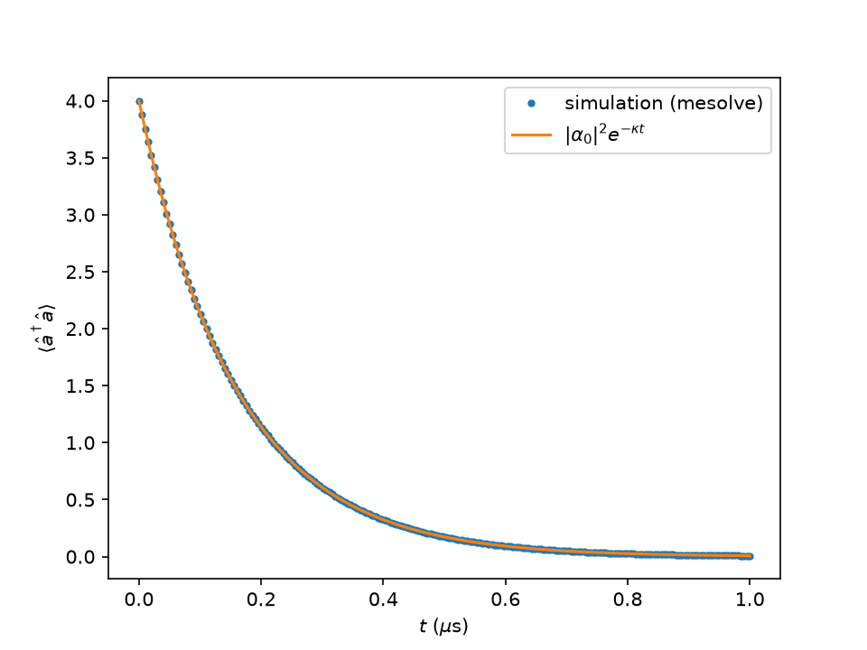

**Figure 1.** Photon number versus time. Dots: simulation. Line: Eq. (2). They lie on top of each other.

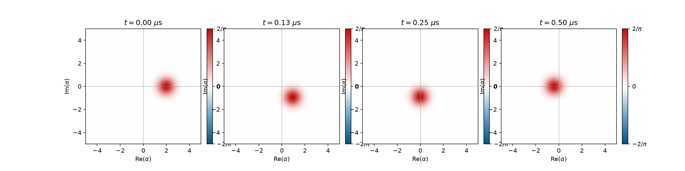

**Figure 2.** Wigner function at $t \approx 0,\ 0.13,\ 0.25,\ 0.50$ µs. The blob circles the origin and moves inward, but stays round the whole time.

### 3.3 Check

| Quantity | Simulation | Expected |
|---|---|---|
| photon number vs. time | follows the curve | $4\,e^{-\kappa t}$, Eq. (2) |
| largest difference from Eq. (2) | printed by the script; at the solver's numerical tolerance (our NumPy check: $5\times10^{-15}$) | 0 |
| photons left at $t = 1$ µs | 0.0075 | $4e^{-2\pi} = 0.0075$ |

This match also confirms our units: if we had forgotten a $2\pi$, the decay would be about 6× too slow.

---

## 4. Task 1.0(b) — Pure two-photon loss

### 4.1 What we expect

Now photons can only leave **in pairs** ($\hat L = \sqrt{\kappa_2}\,\hat a^2$). Two consequences:

1. **Parity never changes.** Removing two photons keeps an even number even and an odd number odd.
2. **$\lvert 0\rangle$ and $\lvert 1\rangle$ are stuck.** You can't remove a pair from 0 or 1 photons ($\hat a^2\lvert 0\rangle = \hat a^2\lvert 1\rangle = 0$).

So every even part of the state falls down to $\lvert 0\rangle$ and every odd part falls down to $\lvert 1\rangle$. The final photon number is just the probability that the starting state had an odd number of photons. For a coherent state the photon number is Poisson-distributed, which gives

$$
\langle\hat a^\dagger\hat a\rangle_{\text{final}} = P_{\rm odd} = e^{-|\alpha_0|^2}\sinh|\alpha_0|^2 = \frac{1 - e^{-2|\alpha_0|^2}}{2}
\;\xrightarrow{\ \alpha_0 = 2\ }\; \frac{1-e^{-8}}{2} = 0.49983 .
\tag{3}
$$

### 4.2 What we see

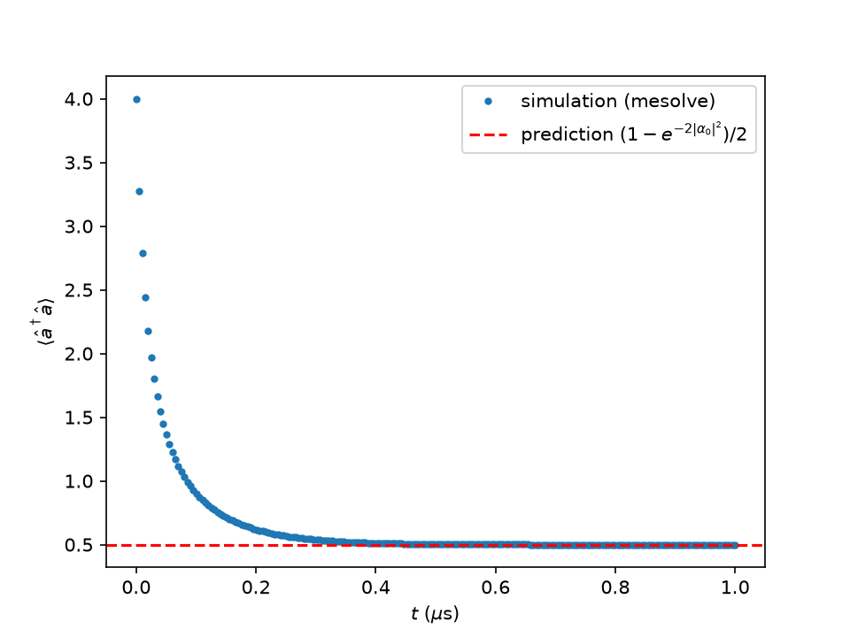

**Figure 3.** Photon number under pure two-photon loss. It drops fast at first (many pairs available), then stops on the red dashed line from Eq. (3).

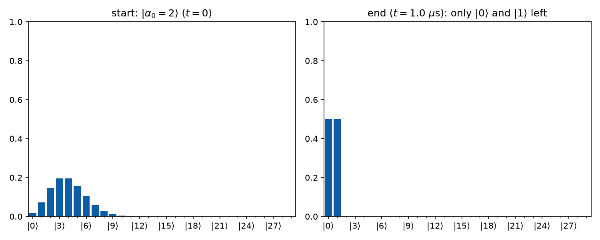

**Figure 4.** Photon-number distribution before and after. Left, $t = 0$: the coherent state $\lvert\alpha_0 = 2\rangle$ has a Poisson distribution with mean $\lvert\alpha_0\rvert^2 = 4$, so levels 3 and 4 are the tallest. Right, $t = 1$ µs: only $\lvert 0\rangle$ and $\lvert 1\rangle$ are left, each holding about half. The even levels have all drained into $\lvert 0\rangle$ and the odd levels into $\lvert 1\rangle$.

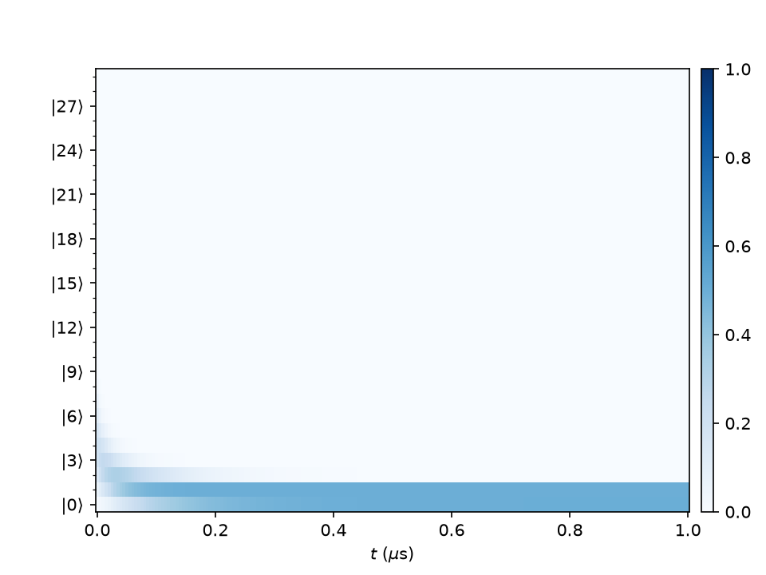

**Figure 5.** The same distribution over time: the higher levels drain into $\lvert 0\rangle$ and $\lvert 1\rangle$ within about 0.4 µs, then nothing changes.

### 4.3 Check

| Quantity | Simulation | Expected |
|---|---|---|
| final photon number | 0.4998 (printed by the script) | 0.49983, Eq. (3) |
| change in parity over the run | printed by the script; ~0 | exactly 0 |

---

## 5. Task 1.0(c) — Stabilization: pairs out and pairs in

### 5.1 What we expect

The jump operator $\sqrt{\kappa_2}\,(\hat a^2 - \alpha^2)$ removes pairs of photons *and* adds pairs back (the two-photon drive). It leaves exactly two states untouched, $\lvert+\alpha\rangle$ and $\lvert-\alpha\rangle$, because $\hat a^2\lvert\pm\alpha\rangle = \alpha^2\lvert\pm\alpha\rangle$. So we expect three things:

* **Where it ends up:** $\langle\hat a^\dagger\hat a\rangle \to \alpha^2 = 4.41$, whatever $\kappa_2$ is.
* **How fast:** if we ignore the small $\kappa_a$, the only rate in the problem is $\kappa_2$. So the whole evolution can depend on time only through the combination $\kappa_2 t$. Doubling $\kappa_2$ must exactly halve every timescale.
* **Which state:** the vacuum has even parity and pairs keep it even, so we land in the **even cat** $\lvert\mathcal C_+\rangle \propto \lvert\alpha\rangle + \lvert-\alpha\rangle$, not in one of the two blobs alone. The small single-photon loss $\kappa_a$ does flip the parity, slowly, at about $2\kappa_a\alpha^2 \approx 0.5$ per µs.

### 5.2 What we see

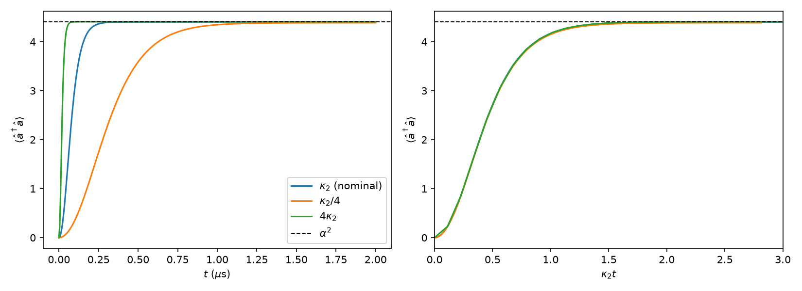

**Figure 6.** Left: photon number starting from vacuum for $\kappa_2/4$, $\kappa_2$ and $4\kappa_2$. All three rise smoothly to $\alpha^2$ (dashed), with no overshoot. Right: the same curves plotted against $\kappa_2 t$. They fall on top of each other, which is the "speed $\propto \kappa_2$" prediction.

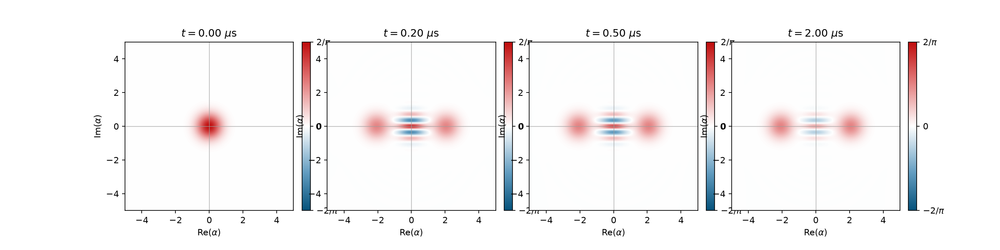

**Figure 7.** Wigner function for nominal $\kappa_2$ at $t = 0,\ 0.20,\ 0.50,\ 2.0$ µs. The single blob at the origin splits into two blobs at $\pm 2.1$ with striped fringes between them. The fringes (which go negative) show the state is a *superposition* of the two blobs, not just "one or the other". By 2 µs the fringes are fainter: that is $\kappa_a$ at work. An animation is in `figures/task1_0/cat_stabilization.gif`.

**Table 3.** Time to get within 1 % of $\alpha^2$ (printed by the script; rounded).

| Rate | Settling time | $\kappa_2 \times$ settling time |
|---|---|---|
| $\kappa_2/4$ | ≈ 1.1 µs | ≈ 1.55 |
| $\kappa_2$ | ≈ 0.25 µs | ≈ 1.4 |
| $4\kappa_2$ | ≈ 0.06 µs | ≈ 1.4 |

The last column is almost constant: 16× change in $\kappa_2$, same number. It drifts a little at $\kappa_2/4$ because there the slow stabilization has more time to compete with $\kappa_a$.

### 5.3 Check

| Quantity | Simulation | Expected |
|---|---|---|
| final photon number | 4.40 | $\alpha^2 = 4.41$ (slightly less because of $\kappa_a$) |
| $\kappa_2 \times$ settling time | 1.4–1.55 | constant |
| parity at 2 µs | 0.37 (printed by the script) | $\approx e^{-2\kappa_a\alpha^2 \cdot 2\,\mu\text{s}} = 0.36$ |

The parity ends a bit above the simple estimate because the cat only reaches full size after about 0.25 µs, and smaller cats lose parity more slowly. This smooth, no-overshoot behaviour is our reference for the full two-mode model in Task 1.1, where the buffer is included explicitly.

---

## 6. Task 1.1 — The full two-mode model: inflating a cat

### 6.1 What we expect

In 1.0(c) we used a shortcut: a single jump operator $\sqrt{\kappa_2}\,(\hat a^2 - \alpha^2)$. Physically, that two-photon dissipation is *engineered* with a second, very lossy mode called the **buffer** ($\hat b$). Now we simulate both modes explicitly:

$$
\hat H_{2\mathrm{ph}} = \underbrace{g_2\,\hat a^2\hat b^\dagger + g_2\,\hat a^{\dagger 2}\hat b}_{\text{2 memory photons} \;\leftrightarrow\; \text{1 buffer photon}} \;\underbrace{-\;\epsilon_d\,(\hat b + \hat b^\dagger)}_{\text{drive on the buffer}},
\qquad \text{jumps: } \sqrt{\kappa_b}\,\hat b,\ \ \sqrt{\kappa_a}\,\hat a .
\tag{4}
$$

The mechanism: the drive fills the buffer, buffer photons convert into **pairs** of memory photons, and the lossy buffer throws away pairs coming the other way. Gain and loss balance at $\alpha^2 = \epsilon_d/g_2 = 4.41$, the same target as before.

The shortcut of 1.0(c) is only valid if the buffer is **much faster than everything else**, so that it never holds photons for long. The condition is $\kappa_b \gg g_2,\ \epsilon_d$. With our parameters:

| Ratio | Value | Needs to be | Satisfied? |
|---|---|---|---|
| $g_2/\kappa_b$ | 0.763 / 2.6 = **0.29** | $\ll 1$ | only barely |
| $\epsilon_d/\kappa_b = \alpha^2 g_2/\kappa_b$ | 3.365 / 2.6 = **1.29** | $\ll 1$ | **no** |

So we expect the two-mode model to **differ from 1.0(c) during the start-up**: the drive is faster than the buffer can empty, so photons pile up in the buffer. In steady state the buffer should be nearly empty again, and the two models should agree.

To look at the memory on its own, we **partial-trace out the buffer**: $\hat\rho_a = \mathrm{Tr}_b\,\hat\rho$ (`dq.ptrace(states, 0)`). This is the memory's state when we ignore whatever the buffer is doing.

### 6.2 What we see

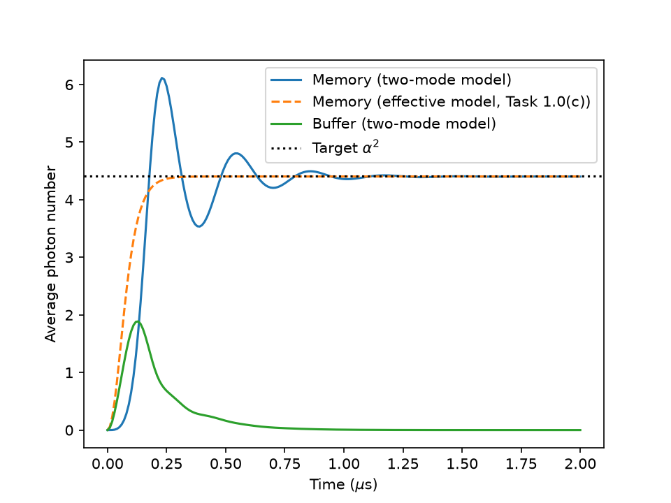

**Figure 8.** Memory and buffer photon numbers in the two-mode model (solid), with the effective 1.0(c) model at nominal $\kappa_2$ overlaid (dashed). Truncation $(N_a, N_b) = (24, 6)$.

What the plot shows:

* **Overshoot.** The effective model rises smoothly to $\alpha^2$ in about 0.25 µs. The two-mode memory starts *later*, then **overshoots to about 6.1 photons** near 0.23 µs, well above 4.41.
* **Ringing.** It then swings below (about 3.5 near 0.4 µs) and back up, oscillating with a period of roughly 0.3 µs, and settles within 1 % of $\alpha^2$ only after about 1 µs.
* **The buffer fills up, then empties.** The buffer jumps to about **1.9 photons** at 0.12 µs, which is *before* the memory peak, and decays to nearly zero by about 0.8 µs.
* **Same destination.** After about 1.2 µs both models sit at the same value just below $\alpha^2$.

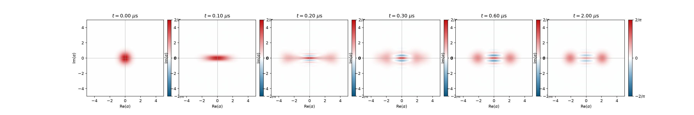

**Figure 9.** Wigner function of the memory alone (buffer traced out) at $t = 0,\ 0.1,\ 0.2,\ 0.3,\ 0.6,\ 2.0$ µs. The vacuum blob first **stretches** along the real axis (0.1 µs), then **splits** into two blobs. At 0.2 µs, during the overshoot, the blobs sit *beyond* $\pm 2.1$ (more photons than $\alpha^2$). By 0.6 µs they have pulled back to $\pm 2.1$, with interference fringes between them: an even cat, as in 1.0(c). An animation is in `figures/task1_1/task1_1_memory_wigner.gif`.

### 6.3 Why the two models differ

The effective model assumes every buffer photon leaks out instantly. Here $\epsilon_d/\kappa_b \approx 1.3$, so at the start the drive pushes photons into the empty buffer faster than $\kappa_b$ can remove them. With no memory pairs yet to absorb them, they **pile up in the buffer** (the 1.9-photon peak). Those stored photons keep converting into memory pairs through the $g_2$ term even after the memory has reached $\alpha^2$, which is the **overshoot**. And because $g_2$ is not small compared with $\kappa_b$, energy **sloshes back and forth** between memory and buffer a few times before $\kappa_b$ damps it out, which is the **ringing**.

In one sentence: *the buffer is not fast enough to be eliminated ($g_2/\kappa_b \approx 0.3$, $\epsilon_d/\kappa_b \approx 1.3$), so it temporarily stores energy, and that stored energy causes the overshoot and the ringing.*

### 6.4 Check

| Quantity | Simulation $(24, 6)$ | Expected |
|---|---|---|
| steady-state $\langle\hat n_a\rangle$ | 4.4028 | $\approx \alpha^2 = 4.41$, same as 1.0(c) |
| steady-state $\langle\hat n_b\rangle$ | $\approx 0$ | $\approx 0$ (buffer empty at the fixed point) |
| peak $\langle\hat n_a\rangle$ | 6.12 at 0.23 µs | larger than $\alpha^2$, since the condition fails |
| peak $\langle\hat n_b\rangle$ | 1.9 | "a couple of photons" |
| is 2 µs long enough? | $\langle\hat n_a\rangle$ changes by $1.5\times10^{-4}$ (relative) between 2 and 4 µs (from the 1.2 grid run at the same truncation) | yes |

**Is this truncation good enough?** The buffer peak of about 2 photons is uncomfortably close to the cutoff $N_b = 6$. Task 1.2 checks this, and finds that $(24, 6)$ gets the **steady state right but cuts the overshoot peak by 11 %** (6.12 instead of the converged 6.91). The qualitative picture above is unchanged; only the height of the first peak is off.

---

## 7. Task 1.2 — Is the answer real or a numerical artifact?

### 7.1 What we are testing

The computer keeps only $N_a$ memory levels and $N_b$ buffer levels. A result is only trustworthy if it **stops changing when we keep more levels**. We test two quantities, because they can behave differently:

* **steady state:** $\langle\hat n_a\rangle$ at $t = 4$ µs;
* **transient:** the overshoot peak $\max_t\langle\hat n_a\rangle(t)$.

Instead of two separate one-dimensional sweeps, we run the **full grid** $N_a \in \{16, 20, 24, 28, 32, 40\}$ × $N_b \in \{4, 6, 8, 10, 12, 14, 16\}$ (42 runs, each to 4 µs), so we can vary each truncation at *every* value of the other. The reference is the largest run, $(40, 16)$. A value counts as **converged** when it is within $10^{-3}$ (0.1 %) of the reference, and stays within it for every larger $N_a$ and $N_b$.

We also check the **semiclassical prediction** $\alpha^2 = \epsilon_d/g_2 = 4.41$ and ask whether any gap is physics or numerics.

### 7.2 What we see

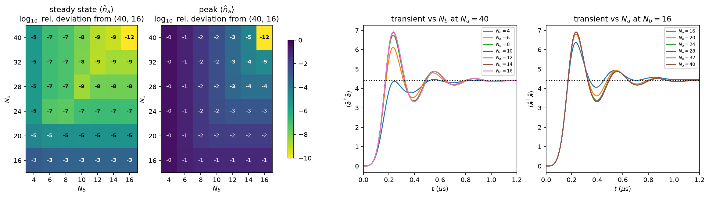

**Figure 10.** Left two panels: how far each $(N_a, N_b)$ is from the reference, as $\log_{10}$ of the relative deviation (−3 means 0.1 %, −5 means 0.001 %; **bold** = converged). Left is the steady state, right is the overshoot peak. Right two panels: the start-up curves for every $N_b$ at $N_a = 40$, and for every $N_a$ at $N_b = 16$.

What the plot shows:

* **The steady state barely cares.** In the left heat map, almost every cell is $10^{-5}$ or better. Only $N_a = 16$ is visibly off ($7\times10^{-4}$).
* **The peak cares a lot.** In the second heat map, small truncations are off by 10–35 %. Only the top-right corner is converged.
* **$N_b$ controls the overshoot.** In the third panel, $N_b = 4$ (blue) almost removes the overshoot (peak 4.4 instead of 6.9), and $N_b = 6$ (orange, the starter value) gives about 6.1. From $N_b = 12$ up, the curves lie on top of each other.
* **$N_a$ matters once the buffer is right.** In the fourth panel, $N_a = 16$ clips the peak at about 6.4. From $N_a = 28$ up, the curves agree.

**Table 4.** Convergence at 0.1 % tolerance (from the script's printout).

| Quantity | Reference $(40,16)$ | Smallest $N_a$ that works, at each $N_b = 4 \to 16$ | Smallest $N_b$ that works, at each $N_a = 16 \to 40$ | Converged corner $(N_a, N_b)$ |
|---|---|---|---|---|
| steady-state $\langle\hat n_a\rangle$ | 4.40276 | 20, then 16 for every $N_b \ge 6$ | 4 everywhere | **(20, 4)** |
| peak $\langle\hat n_a\rangle$ | 6.911 at 0.235 µs | 20, 20, 24, 24, 28, 28, 28 | 14, then 12 | **(28, 12)** |

**Table 5.** How wrong the peak is at a few truncations.

| $(N_a, N_b)$ | Peak $\langle\hat n_a\rangle$ | Error |
|---|---|---|
| $(40, 4)$ | 4.46 | −35 % |
| $(24, 6)$, starter, used in Task 1.1 | 6.12 | −11 % |
| $(16, 16)$ | 6.37 | −8 % |
| $(28, 12)$ | 6.91 | < 0.1 % |

### 7.3 Which truncation matters for which quantity, and why

* **Steady state: only $N_a$, and only a little.** At the fixed point the buffer is essentially empty: the drive and the pair conversion cancel. So even $N_b = 4$ is fine. The memory holds a cat with about 4.4 photons and a Poisson-like spread, so levels above about 20 are empty.
* **Transient: $N_b$ first, then $N_a$.** At the start the drive fills the buffer before there are memory pairs to absorb it, so the buffer briefly holds about 2 photons, spread over many levels. Cutting the buffer off at 4 or 6 levels **removes part of the "pump"** that over-inflates the memory, so the peak comes out too small. Once the buffer is right, the memory overshoots to 6.9 photons with a wider spread, and that needs $N_a \approx 28$ instead of 20.
* **Why the full grid matters.** A one-dimensional sweep can mislead. At $N_b = 4$–6, the peak *looks* converged in $N_a$ already at 20, but only because the clipped buffer has already removed most of the overshoot, leaving less memory population to clip. The real requirement, $N_a = 28$, only shows up once $N_b \ge 12$.

**The truncation monitor agrees.** At the starter $(24, 6)$, the top buffer level $\lvert 5\rangle$ holds up to **4.6 %** of the population during the overshoot, while the top two memory levels stay below $10^{-4}$. So the buffer, not the memory, is the problem. At $(28, 12)$ both stay at or below $2\times10^{-4}$.

**Answer to "which one is too small?":** $N_b = 6$. It is fine for the steady state but too small for the start-up transient.

### 7.4 Semiclassical check: is the gap from $\alpha^2$ real?

The converged steady state is $\langle\hat n_a\rangle = 4.40276$, which is **0.16 % below** $\alpha^2 = 4.41$. That is well within "a few percent", and it is converged to better than $10^{-4}$ for every $N_a \ge 20$, so it is **not a numerical artifact**. It is physics, with two small sources:

1. **The state is an even cat, not a coherent state.** Even with $\kappa_a = 0$, vacuum inflates into $\lvert\mathcal C_+\rangle$ (parity is conserved, as in 1.0(b)). Its photon number is $\alpha^2\tanh\alpha^2 = 4.4087$, slightly below $\alpha^2$. That accounts for about −0.03 %.
2. **Single-photon loss shrinks the cat.** With $\kappa_a$ on, a simple mean-field estimate gives $\alpha^2 - \kappa_a/(2\kappa_2) = 4.4048$. That accounts for most of the rest.

The last cell of `task1_2_convergence_grid.py` runs the two-mode model with $\kappa_a = 0$ (which should print about 4.4087) and repeats one run with a 100× tighter solver tolerance (which should change nothing beyond $10^{-9}$).

### 7.5 Check

| Quantity | Result | Expected |
|---|---|---|
| converged steady state | 4.40276 | $\alpha^2 = 4.41$, minus small physical corrections |
| gap from $\alpha^2$ | −0.16 % | "a few percent" at most |
| converged corner, steady state | (20, 4) | — |
| converged corner, peak | (28, 12) | — |
| starter (24, 6), steady state | 4.40276 (error $<10^{-6}$) | — |
| starter (24, 6), peak | 6.12 (−11 %) | — |

**Recommendation:** use $(28, 12)$ for anything involving the start-up transient. For steady-state or slow, long-time quantities, $(20, 4\text{–}6)$ is enough and roughly 4× cheaper.

---

## 8. Task 1.3 — Which state did we prepare, and how to prepare $\lvert 0_L\rangle$

Script: `code/task1_3.py` (copied from our experiments notebook). It runs at the **converged truncation $(N_a, N_b) = (28, 12)$** from Task 1.2, runs every simulation twice (nominal $\kappa_a$ and $\kappa_a = 0$), and tracks parity, fidelity with the even cat, and purity. Like Task 1.2, it saves figures to `figures/` relative to where it is run; we run it from `code/`.

### 8.1 Part (a): what we expect

**Claim:** starting from vacuum, the stabilization prepares the **even cat** $\lvert\mathcal C_+\rangle \propto \lvert{+\alpha}\rangle + \lvert{-\alpha}\rangle$, not one of the codewords $\lvert\pm\alpha\rangle$.

**Why, in three steps:**

1. **The conserved quantity is memory parity**, $\hat P = e^{i\pi\hat a^\dagger\hat a}$ (+1 for an even photon number, −1 for odd). Every term of the stabilization changes the memory photon number by 0 or 2: $g_2\hat a^2\hat b^\dagger$ removes two, $g_2\hat a^{\dagger 2}\hat b$ adds two, and the buffer drive and buffer loss don't touch the memory at all. So, exactly as in Task 1.0(b), **pair processes never change parity**.
2. **The vacuum is even:** $\hat P\lvert 0\rangle = +\lvert 0\rangle$, so $\langle\hat P\rangle = +1$ at $t = 0$, and it stays +1.
3. **Only one state fits.** The stabilization pushes the memory into the space spanned by $\lvert\pm\alpha\rangle$. The only state in that space with parity +1 is $\lvert\mathcal C_+\rangle$. A codeword like $\lvert{+\alpha}\rangle$ has $\langle\hat P\rangle = e^{-2\alpha^2} \approx 0$, so it is unreachable.

**What breaks it, as one equation.** Parity $\hat P_a$ commutes with every pair term and every buffer term, so only single-photon loss $\sqrt{\kappa_a}\,\hat a$ can change it. Because $\hat a\hat P_a = -\hat P_a\hat a$ (removing one photon flips even ↔ odd), Eq. (1) gives

$$
\frac{d\langle\hat P_a\rangle}{dt} = -2\kappa_a\,\langle\hat P_a\,\hat a^\dagger\hat a\rangle \;\approx\; -2\kappa_a\alpha^2\,\langle\hat P_a\rangle
\qquad\Rightarrow\qquad \langle\hat P_a\rangle(t) \approx e^{-\Gamma_Z t},\quad \Gamma_Z = 2\kappa_a\alpha^2 = 0.515\ \mu\text{s}^{-1}.
\tag{5}
$$

So we expect: with $\kappa_a = 0$, parity stays **exactly** +1 and the state is a perfect $\lvert\mathcal C_+\rangle$; with $\kappa_a$ on, parity decays at $\Gamma_Z$.

**Three ways to tell a superposition from a mixture:**

| | $\langle\hat P_a\rangle$ | purity $\mathrm{Tr}\,\hat\rho_a^2$ | Wigner fringes |
|---|---|---|---|
| superposition $\lvert\mathcal C_+\rangle$ | +1 | 1 | yes |
| mixture $\tfrac12\big(\lvert\alpha\rangle\langle\alpha\rvert + \lvert{-\alpha}\rangle\langle{-\alpha}\rvert\big)$ | ≈ 0 | 1/2 | no |

Parity and fringes are the same measurement in disguise: the Wigner function at the origin is $W(0) = \tfrac{2}{\pi}\langle\hat P_a\rangle$. A mixture of two blobs is positive everywhere, so **any negative fringe proves a superposition**.

### 8.2 Part (a): what we see

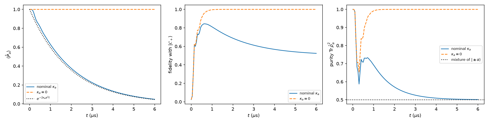

**Figure 11.** Memory parity (left), fidelity with $\lvert\mathcal C_+\rangle$ (middle) and purity (right) from vacuum, for nominal $\kappa_a$ (solid) and $\kappa_a = 0$ (dashed). Dotted lines: the prediction $e^{-2\kappa_a\alpha^2 t}$ (left) and the mixture's purity 1/2 (right).

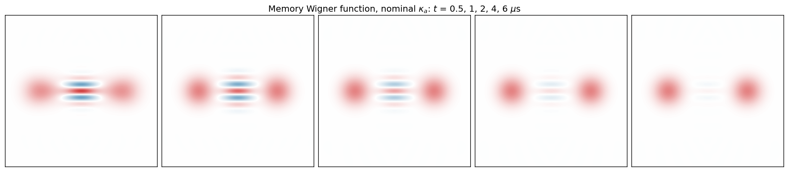

**Figure 12.** Memory Wigner function with nominal $\kappa_a$ at $t = 0.5,\ 1,\ 2,\ 4,\ 6$ µs. The blobs stay put; the fringes between them fade.

* **With $\kappa_a = 0$ it is a perfect cat.** Parity stays at +1 to within $10^{-15}$ for all time. After the transient, fidelity with $\lvert\mathcal C_+\rangle$ and purity are both 1.0000 at 2 µs. The only dip in purity, near 0.3 µs, is temporary entanglement with the buffer during the overshoot (Task 1.1).
* **With $\kappa_a$ on, parity decays as predicted.** A fit after the transient ($t \ge 1.5$ µs) gives $\Gamma = 0.513\ \mu\text{s}^{-1}$, against $2\kappa_a\alpha^2 = 0.515\ \mu\text{s}^{-1}$. Some parity is already lost during inflation, so the fidelity peaks at only about 0.84, near 0.6 µs.
* **Superposition first, mixture later.** Early on, parity is 0.6–0.8 (the mixture has 0) and the fringes are clearly visible. Then parity, purity and fringes decay **together**: parity → 0, purity → 1/2, and by 6 µs the fringes have almost vanished (parity ≈ 0.05), leaving nearly the mixture of $\lvert\pm\alpha\rangle$.
* **How long it stays a superposition.** Parity stays above 1/2, meaning the state is *mostly* the superposition, for about **1.5 µs**. The coherence lifetime is $1/\Gamma \approx 1.95$ µs.

### 8.3 Part (b): preparing $\lvert 0_L\rangle = \lvert{+\alpha}\rangle$

Starting from vacuum can never pick a side: the vacuum and the stabilization are both symmetric under $\alpha \to -\alpha$, so the result is always 50/50 between the two blobs. To get $\lvert{+\alpha}\rangle$ we have to **break that symmetry**. The stabilization has two "valleys" (Section B.8), roughly the right and left half-planes. A state that starts in, or is pushed into, the right half flows to $+\alpha$, and once there it stays, because bit flips are exponentially suppressed. We tried two ways to do this.

**Method 1: start displaced.** Begin in a coherent state $\lvert\beta\rangle$ with $\beta > 0$ (as if a short displacement pulse came first), then let the stabilization run. We model the pulse as ideal and scan $\beta$.

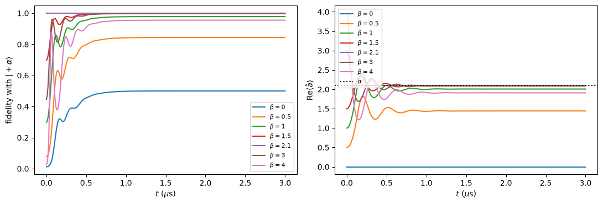

**Figure 13.** Fidelity with $\lvert{+\alpha}\rangle$ (left) and $\mathrm{Re}\langle\hat a\rangle$ (right) after starting in $\lvert\beta\rangle$, for $\beta = 0$ to 4.

**Table 6.** Method 1 results (printed by the script).

| $\beta$ | $F(\lvert{+\alpha}\rangle)$ at 1 µs | $F(\lvert{+\alpha}\rangle)$ at 3 µs | $F(\lvert{-\alpha}\rangle)$ at 3 µs | $\mathrm{Re}\langle\hat a\rangle$ at 3 µs |
|---|---|---|---|---|
| 0 | 0.498 | 0.500 | 0.50 | 0.000 |
| 0.5 | 0.842 | 0.844 | 0.16 | 1.442 |
| 1.0 | 0.978 | 0.978 | 0.022 | 2.007 |
| 1.5 | 0.9986 | 0.9988 | 0.0012 | 2.093 |
| **2.1** ($= \alpha$) | **0.99999** | **0.99999** | $5\times10^{-7}$ | **2.098** |
| 3.0 | 0.9974 | 0.9977 | 0.0023 | 2.089 |
| 4.0 | 0.954 | 0.955 | 0.045 | 1.910 |

* **No displacement, no choice.** $\beta = 0$ is exactly 50/50, as the symmetry argument says.
* **A small push is enough.** $\beta = 1.5$ already gives 0.9988, and $\beta = \alpha = 2.1$ gives 0.99999: the state starts essentially *at* the target, so there is nothing left to correct.
* **The choice is locked in.** Fidelity at 1 µs and at 3 µs is the same: once the state has picked a valley it stays, and $\kappa_a$ doesn't harm a coherent codeword (it shrinks a coherent state but never flips it, Task 1.0(a)).
* **Too big a push is worse, not better.** $\beta = 3$ and especially $\beta = 4$ do worse than $\beta = 2.1$; at $\beta = 4$, 4.5 % of the population ends up at $-\alpha$. We have not pinned down why. Two candidates: starting with 16 photons drives the buffer hard, pushing the system deeper into the non-adiabatic regime of Task 1.1, and 16 photons with a spread of ±4 sits close to the $N_a = 28$ cutoff, so a truncation check at larger $N_a$ is needed before trusting the $\beta = 4$ number.
* **Why small $\beta$ fails.** The part of $\lvert\beta\rangle$ that lies in the left half-plane flows to $-\alpha$. For small $\beta$ that part is large; it shrinks quickly as $\beta$ grows.

**Method 2: push during inflation, starting from vacuum.** Keep the vacuum start, but add a short drive on the memory, $\hat H_Z = i\,\epsilon_z(\hat a^\dagger - \hat a)$, which pushes $\langle\hat a\rangle$ along $+\mathrm{Re}$. It is on for the first $\tau$ (100 or 150 ns) and then switched off, while the stabilization runs throughout. This is closer to what an experiment would do: one pulse, during the inflation, instead of preparing $\lvert\beta\rangle$ perfectly.

**Table 7.** Method 2 results at 3 µs (printed by the script).

| Pulse length $\tau$ | $\epsilon_z/2\pi$ | $F(\lvert{+\alpha}\rangle)$ | $F(\lvert{-\alpha}\rangle)$ | $\mathrm{Re}\langle\hat a\rangle$ |
|---|---|---|---|---|
| 100 ns | 2.0 MHz | 0.975 | 0.025 | 1.993 |
| 150 ns | 2.0 MHz | 0.986 | 0.014 | 2.038 |
| **100 ns** | **3.0 MHz** | **0.9966** | 0.0034 | **2.084** |
| 100 ns | 4.0 MHz | 0.993 | 0.0068 | 2.070 |

* **It works from vacuum.** A 100 ns pulse at 3 MHz gives $F(\lvert{+\alpha}\rangle) = 0.9966$, without ever preparing a displaced state.
* **More drive helps, up to a point.** Longer or stronger pulses help at first (0.975 → 0.986 → 0.9966), but 4 MHz is slightly worse than 3 MHz. As with large $\beta$ in Method 1, pushing too hard during the inflation transient over-shoots the target; the best of the four settings we tried is 100 ns at 3 MHz.

**Method 2, optimized: a sweep of 91 pulses.** The four settings above suggested that the pulse's *strength* and *length* trade off. To find the best pulse we swept 7 durations ($\tau$ = 25 to 300 ns) × 13 **pulse areas** $A = \epsilon_z\tau$ (0.5 to 3.5), measuring the infidelity $1 - F(\lvert{+\alpha}\rangle)$ at 1.5 µs. The pulse area is the natural variable: without the stabilization, a drive $i\epsilon_z(\hat a^\dagger - \hat a)$ applied for time $\tau$ displaces the vacuum to $\lvert\beta\rangle$ with $\beta = \epsilon_z\tau = A$. So $A$ plays the role of $\beta$ in Method 1.

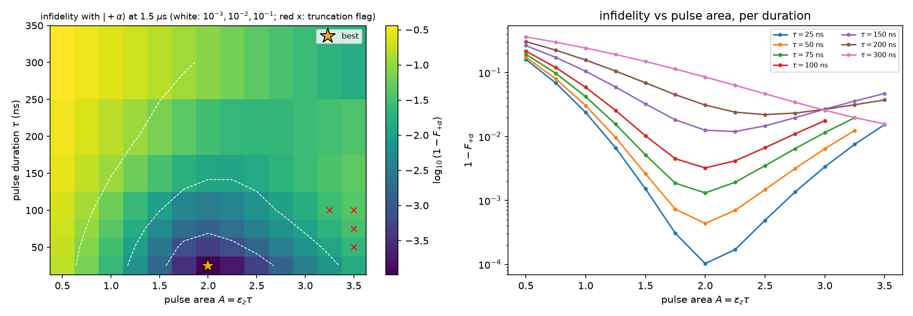

**Figure 14.** Left: infidelity with $\lvert{+\alpha}\rangle$ at 1.5 µs over pulse duration and pulse area ($\log_{10}$ scale; white contours at $10^{-3}$, $10^{-2}$, $10^{-1}$; star = best; red × = runs flagged for truncation). Right: the same infidelity against pulse area, one curve per duration.

**Table 8.** Best pulse area at each duration.

| Pulse duration $\tau$ | Best area $A$ | Drive $\epsilon_z/2\pi$ | $F(\lvert{+\alpha}\rangle)$ |
|---|---|---|---|
| **25 ns** | **2.0** | **12.7 MHz** | **0.99990** |
| 50 ns | 2.0 | 6.4 MHz | 0.99956 |
| 75 ns | 2.0 | 4.2 MHz | 0.99869 |
| 100 ns | 2.0 | 3.2 MHz | 0.99678 |
| 150 ns | 2.25 | 2.4 MHz | 0.988 |
| 200 ns | 2.5 | 2.0 MHz | 0.978 |
| 300 ns | 3.5 (edge of sweep) | 1.9 MHz | 0.984 |

* **Best pulse: 25 ns at 12.7 MHz.** It gives $F(\lvert{+\alpha}\rangle) = 0.99990$, with only $9\times10^{-5}$ of the population on $\lvert{-\alpha}\rangle$. That is 30× lower infidelity than the best of the first four settings (0.9966).
* **The best area is about 2.0, close to $\alpha = 2.1$.** For every duration up to 100 ns the optimum sits at $A = 2.0$: the pulse works best when it moves the state to roughly where the $+\alpha$ cat will sit, which is the same lesson as $\beta \approx \alpha$ in Method 1. Too little leaves part of the state on the $-\alpha$ side; too much overshoots past $+\alpha$ and the stabilization has to pull it back, which costs fidelity.
* **Shorter is better.** The stabilization is on throughout and works against a slow pulse. A 25 ns pulse is almost instantaneous compared with the stabilization (about 0.25 µs), so it acts like the ideal displacement of Method 1. For long pulses the optimum shifts to larger areas, and at 300 ns it sits at the edge of the sweep.
* **Truncation.** A few runs with large area at 50–100 ns (red ×) were flagged by the truncation monitor; none of them are near the optimum.

### 8.4 Part (c): what the method costs

* **An extra control line, or a second tone.** Both methods need a resonant drive on the *memory*. The memory is designed to be as isolated as possible (its loss $\kappa_a$ is tiny), so coupling a strong drive to it works against that design.
* **Amplitude and timing calibration.** Tables 6–8 show that too weak a push leaves errors and too strong a push also hurts, so the pulse amplitude and length need tuning, although there is a broad range that works (for Method 1, $\beta$ from about 1.5 to 3 gives $F \ge 0.997$).
* **Interaction with the stabilization.** In Method 2 the drive is on *while* the stabilization is inflating the cat, so the two compete. That is why the result depends on the pulse settings in a non-trivial way.
* **Extra time.** Method 2 adds only a 25 ns pulse (at $\epsilon_z/2\pi = 12.7$ MHz), which overlaps with the inflation, so the preparation time barely grows. Method 1 needs a separate displacement step first.

### 8.5 Check

| Quantity | Result | Expected |
|---|---|---|
| parity with $\kappa_a = 0$ | $1$ to within $10^{-15}$ | exactly 1 (parity conserved) |
| fidelity and purity with $\kappa_a = 0$, at 2 µs | 1.0000 and 1.0000 | 1 (a pure $\lvert\mathcal C_+\rangle$) |
| fitted parity decay rate | 0.513 µs⁻¹ | $2\kappa_a\alpha^2 = 0.515$ µs⁻¹, Eq. (5) |
| long-time purity | → 1/2 | 1/2 for the mixture of $\lvert\pm\alpha\rangle$ |
| Method 1, $\beta = 0$ | 50 / 50 | 50 / 50 by symmetry |
| $\mathrm{Re}\langle\hat a\rangle$ vs. $\alpha\,(F_+ - F_-)$, Method 1 at $\beta = 0.5$ | 1.442 vs. 1.436 | equal when the state sits on the two blobs |
| best $F(\lvert{+\alpha}\rangle)$ | 0.99999 (Method 1, $\beta = \alpha$); 0.99990 (Method 2, 25 ns at 12.7 MHz, from vacuum) | close to 1 |
| Method 2 best pulse area | 2.0 | $\approx \alpha = 2.1$ (a pulse of area $A$ displaces vacuum to $\beta = A$) |

---

## 9. Summary

| Task | What happens | Why | Checked against |
|---|---|---|---|
| 1.0(a) | state spirals in but stays coherent | removing a photon doesn't change a coherent state | Eq. (2) |
| 1.0(b) | photon number stops at 0.4998 | pairs only → parity is fixed; $\lvert0\rangle$, $\lvert1\rangle$ are stuck | Eq. (3) |
| 1.0(c) | vacuum grows into an even cat at $\alpha^2$ | $\lvert\pm\alpha\rangle$ are the only untouched states; only rate is $\kappa_2$ | $\alpha^2$, $\kappa_2 t$ collapse, parity decay |
| 1.1 | same cat, but overshoot to ~1.5× $\alpha^2$ and ringing | buffer too slow: $g_2/\kappa_b \approx 0.3$, $\epsilon_d/\kappa_b \approx 1.3$ | steady state vs. 1.0(c) |
| 1.2 | steady state converged at (20, 4); peak needs (28, 12) | buffer holds ~2 photons during start-up | 42-run grid; $\alpha^2\tanh\alpha^2$ and mean-field estimate |
| 1.3(a) | vacuum → even cat (best overlap 0.84), which decays to a mixture in ~1.9 µs | memory parity is conserved by pair processes, flipped only by $\kappa_a$ | reference cat vs. mixture; $2\kappa_a\alpha^2$ |
| 1.3(b) | $\lvert{+\alpha}\rangle$ with fidelity 0.99999 (start at $\beta = \alpha$) or 0.99990 (25 ns push from vacuum) | breaking the $\pm\alpha$ symmetry picks a valley; bit flips keep it there | $\beta = 0$ gives 50/50; $\mathrm{Re}\langle\hat a\rangle \approx \alpha(F_+ - F_-)$ |

## 10. Reproducing the results

```bash
pip install -r requirements.txt
python code/task1_0a_single_photon_loss.py   # Figures 1-2 + check numbers
python code/task1_0b_two_photon_loss.py      # Figures 3-5 + check numbers
python code/task1_0c_stabilization.py        # Figures 6-7, GIF + settling times and parity
python code/task1_0_numpy_check.py           # optional: same physics with NumPy (~10 s)
python code/task1_1_two_mode_inflation.py    # Figures 8-9, GIF + ratios and peak values
cd code && python task1_2_convergence_grid.py # Figure 10 + Tables 4-5 (first run ~20 min, then cached)
cd code && python task1_3.py                 # Figures 11-13 + Tables 6-7 (Section 8); the 91-pulse sweep (Figure 14, Table 8) is not in this script yet
```

Each Task 1.0 and 1.1 script saves its figures into `figures/<task>/`, wherever it is run from, and prints the numbers used in the check tables. The Task 1.2 script saves to `figures/` and caches its grid in `results/convergence_grid.npz` relative to the folder it is run from; we run it from `code/`, so its outputs are in `code/figures/` and `code/results/`. Delete the cache to recompute.

### Repository layout

```text
DuQuantum/
├── README.md                          this write-up
├── requirements.txt
├── code/
│   ├── cat_model.py                   shared two-mode model (Tasks 1.1–1.3)
│   ├── task1_0a_single_photon_loss.py
│   ├── task1_0b_two_photon_loss.py
│   ├── task1_0c_stabilization.py
│   ├── task1_0_numpy_check.py         optional NumPy sanity check for 1.0(a)–(c)
│   ├── task1_1_two_mode_inflation.py
│   ├── task1_2_convergence.py         1.2 convergence grid (without the semiclassical check)
│   ├── task1_2_convergence_grid.py    1.2 convergence grid + semiclassical and solver checks
│   ├── figures/  results/             outputs of the 1.2 and 1.3 scripts
│   ├── task1_3.py                     1.3(a)-(b) at (28, 12): parity, fidelity, purity; displaced start; drive pulse
│   ├── task1_3_logical_state.py       earlier 1.3(a), (b) version from the repo history
│   └── task1_3_fock_inflation.py      earlier 1.3 extension: inflating from |0⟩ and |1⟩
├── figures/
│   └── task1_0/  task1_1/  task1_2/  task1_3/
└── docs/
```

## 11. What went wrong, and what we learned

* **Units.** Every rate is given as $f$ but must go into the code as $2\pi f$. Getting 1.0(a) to sit exactly on $4e^{-\kappa t}$ was our proof that the conversion is right.
* **A forgotten parameter.** Our first 1.0(c) run had $\kappa_a = 0$ (left as a TODO). The photon-number curves barely changed, but the fringes stayed perfectly sharp. Turning $\kappa_a$ on showed the slow parity decay, which is exactly the phase-flip error cat qubits still have.
* **Bookkeeping bugs.** While reviewing the code we found that our 1.0(a) and 1.0(b) scripts saved to the same file name, so one plot silently replaced the other, and that the "final" Fock plot was actually showing the starting state (`states[0]` instead of `states[-1]`).
* **A starter value that was too small.** The suggested $N_b = 6$ looked fine for the steady state, but the convergence grid showed it cuts the overshoot by 11 %. We learned to test the transient and the steady state separately, and to vary both truncations together rather than one at a time.
* **Reading the model's limits from the parameters.** Computing $g_2/\kappa_b$ and $\epsilon_d/\kappa_b$ told us *before* simulating that the effective model would fail during start-up.
* **The physics insight.** Task 1.0(b) taught us that two-photon processes conserve parity. That one fact explains why stabilizing from vacuum gives a cat *superposition* rather than a single logical state, which is the starting point for Task 1.3. In 1.3(a) the same fact, together with parity, purity and the Wigner fringes, let us identify the prepared state and watch it turn into a mixture.
* **Pushing harder is not always better.** In 1.3(b), both a larger starting displacement and a stronger drive pulse eventually made the fidelity *worse*. Overshooting the target during the non-adiabatic transient matters as much as reaching it.

## 12. Use of AI tools

As the challenge rules allow, we used Claude (Anthropic) to review our scripts (it pointed out the bugs in Section 11), to add the printed check numbers and a few plot panels, to write the optional NumPy check script, and to help draft this README. For Task 1.3 it helped write up the results of our `task1_3.py` and draft the cost discussion in Section 8.4. For Tasks 1.1 and 1.2 it also helped add the effective-model overlay and Wigner snapshots to the 1.1 script and write up the results. We can explain every equation and figure above, and we checked every number against the formulas in Eqs. (2)–(5) and against the convergence grid.

## References

1. U. Réglade, A. Bocquet *et al.*, "Quantum control of a cat qubit with bit-flip times exceeding ten seconds," arXiv:2307.06617 (2023).
2. D. Manzano, "A short introduction to the Lindblad master equation," arXiv:1906.04478 (2019).
3. A. Joshi, K. Noh, Y. Y. Gao, "Quantum information processing with bosonic qubits in circuit QED," arXiv:2008.13471 (2020).
4. `dynamiqs` documentation, https://www.dynamiqs.org
